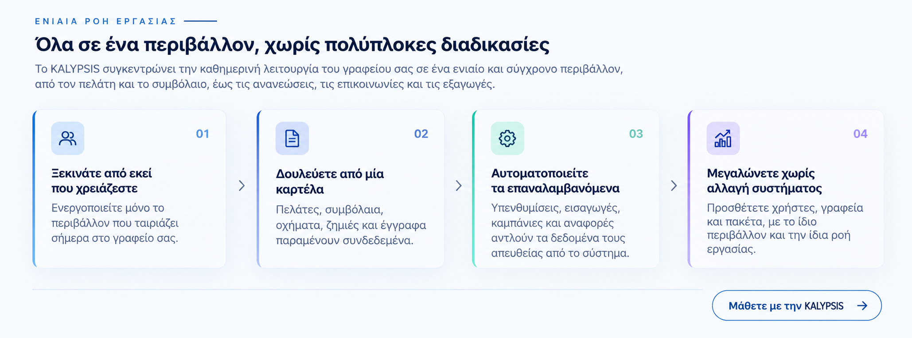

  

<h1 align="center">KALYPSIS CLI</h1>

Δημόσιο έργο γραμμής εντολών στο οικοσύστημα KALYPSIS.

[Ελληνικά](README.el.md) · [English](README.md)

[Ιστότοπος](https://mykalypsis.gr/) · [Αποθετήριο](https://github.com/PanagiotisKotsorgios/kalypsis-cli) · [Συνεισφορά](CONTRIBUTING.el.md) · [Issues](https://github.com/PanagiotisKotsorgios/kalypsis-cli/issues)

Το **KALYPSIS CLI** είναι το δημόσιο αποθετήριο του έργου γραμμής εντολών για Windows.
Δείτε την τεκμηρίωση, συζητήστε ιδέες και συμβάλετε στη διαμόρφωσή του.
Η πρόσβαση στο αποθετήριο είναι δωρεάν για όλους.

## Τρέχουσα κατάσταση

Η εφαρμογή CLI **δεν έχει υλοποιηθεί**. Προς το παρόν το αποθετήριο περιέχει
μόνο πληροφορίες για το έργο και οδηγίες συνεισφοράς. Δεν υπάρχει εκτελέσιμο,
πρόγραμμα εγκατάστασης, έκδοση, υποστηριζόμενες εντολές ή διαδικασία εγκατάστασης.

Το KALYPSIS Web και το Desktop είναι ξεχωριστές εφαρμογές. Το αποθετήριο αυτό
δεν περιέχει τον πηγαίο κώδικά τους και δεν παρέχει πρόσβαση στα συστήματα
ή στα δεδομένα πελατών τους.

## Το οικοσύστημα KALYPSIS

Μία συνδεδεμένη ροή: πελάτες, συμβόλαια, οχήματα, ανανεώσεις και επικοινωνίες.

*Η εικόνα αναφοράς που δόθηκε παρουσιάζει τη σχεδιαστική κατεύθυνση της ενότητας
ροής εργασίας του ιστοτόπου KALYPSIS. Δεν είναι screenshot του CLI και δεν
περιγράφει υλοποιημένες λειτουργίες του CLI.*

## Ταυτότητα έργου

`kalypsis` · `kalypsis-subsystem` · `cli` · `windows` · `insurance` · `documentation`

Το λογότυπο KALYPSIS προσδιορίζει το οικοσύστημα του έργου. Η πρόσβαση στο
αποθετήριο δεν παρέχει δικαιώματα στο εμπορικό σήμα ή στις ξεχωριστές εμπορικές
εφαρμογές. Δεν έχει επιλεγεί ακόμη άδεια ανοιχτού κώδικα για το αποθετήριο·
η δημόσια προβολή δεν αποτελεί άδεια λογισμικού.

## Συνεισφορά

Διαβάστε τις [οδηγίες συνεισφοράς](CONTRIBUTING.el.md) πριν δημιουργήσετε
ένα issue ή pull request. Προτάσεις και βελτιώσεις της τεκμηρίωσης είναι
ευπρόσδεκτες. Συζητήστε πρώτα τις προτάσεις υλοποίησης με τον υπεύθυνο του
έργου· μην θεωρείτε εγκεκριμένη κάποια λειτουργία, API ή τεχνολογική στοίβα.

Μην υποβάλλετε κωδικούς πρόσβασης, tokens, διαπιστευτήρια παραγωγής ή πραγματικά
δεδομένα ασφαλισμένων και πελατών. Χρησιμοποιείτε μόνο συνθετικά παραδείγματα.

## Σύνδεσμοι

- [Ιστότοπος KALYPSIS](https://mykalypsis.gr/)
- [Αποθετήριο έργου](https://github.com/PanagiotisKotsorgios/kalypsis-cli)
- [Οδηγίες συνεισφοράς στα Ελληνικά](CONTRIBUTING.el.md)
- [Contribution guidelines in English](CONTRIBUTING.md)
