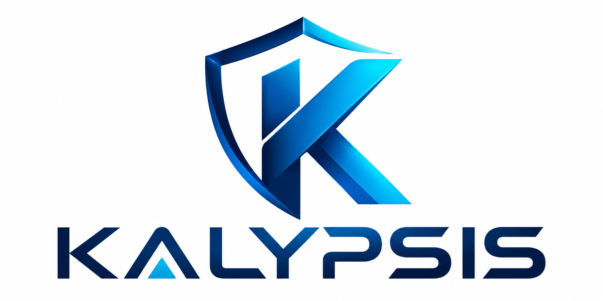
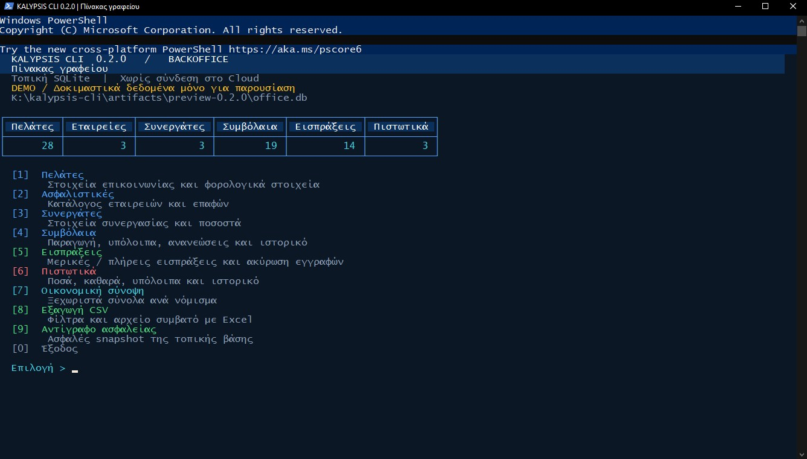
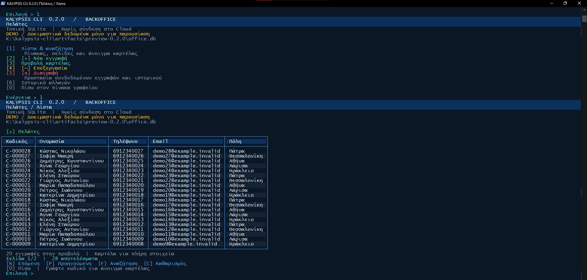
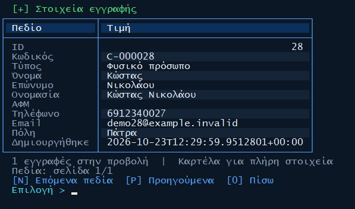
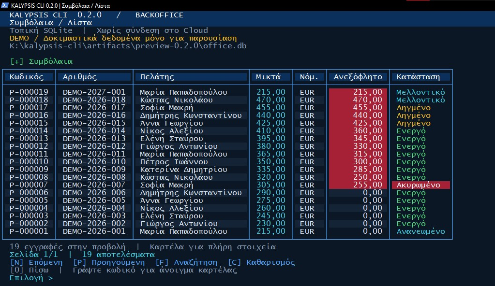
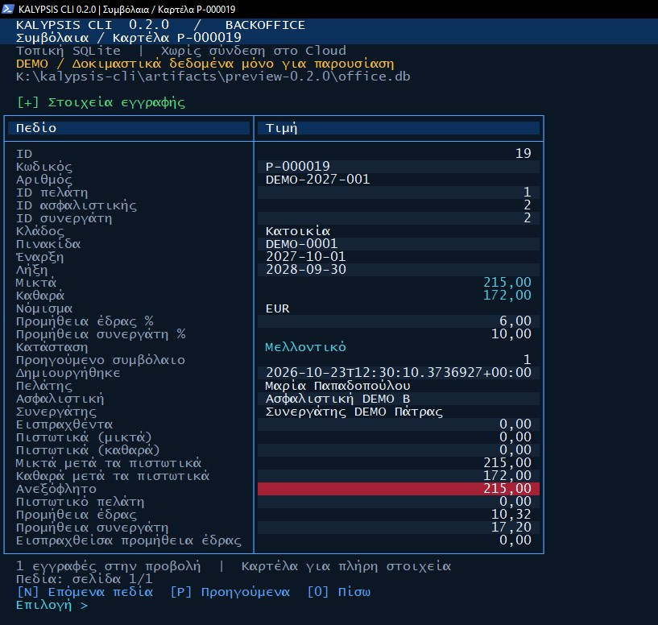

<p align="center">
  <a href="https://mykalypsis.gr/"></a>
</p>

<h1 align="center">KALYPSIS CLI</h1>

<p align="center">Δημόσιο έργο γραμμής εντολών στο οικοσύστημα KALYPSIS.</p>

<p align="center"></p>

[Ελληνικά](README.el.md) · [English](README.md)

[Ιστότοπος](https://mykalypsis.gr/) · [Αποθετήριο](https://github.com/PanagiotisKotsorgios/kalypsis-cli) · [Συνεισφορά](CONTRIBUTING.el.md) · [Issues](https://github.com/PanagiotisKotsorgios/kalypsis-cli/issues)

Το **KALYPSIS CLI 0.2.0** είναι ένα μικρό, αυτόνομο backoffice ασφαλιστικού
γραφείου για το τερματικό Windows, γραμμένο σε **C# / .NET 10**, με τοπική βάση **SQLite**.
Λειτουργεί offline, χωρίς λογαριασμό KALYPSIS Cloud ή ξεχωριστό server βάσης.

## Τρέχουσα κατάσταση

Το **πρωτότυπο 0.2.0** περιλαμβάνει τη βασική ροή backoffice:

- Πελάτες, ασφαλιστικές και συνεργάτες: προσθήκη, αναζήτηση, προβολή, επεξεργασία και διαγραφή ασύνδετων εγγραφών.
- Συμβόλαια: μικτά/καθαρά ασφάλιστρα, συνδέσεις με πελάτη/εταιρεία/συνεργάτη, ποσοστά προμηθειών, ιστορικό ανανέωσης και κατάσταση ακύρωσης.
- Εισπράξεις: μερική ή πλήρης είσπραξη, προστασία από υπερπληρωμή και ακύρωση λανθασμένης εγγραφής με διατήρηση ιστορικού.
- Οικονομική σύνοψη ανά νόμισμα, εξαγωγές CSV UTF-8 με φίλτρα και συνεπή αντίγραφα ασφαλείας.
- Ελληνικό διαδραστικό μενού και μηνύματα, εντολές για scripts με `--json` και σταθερούς κωδικούς εξόδου.

## Διαδραστικό περιβάλλον 0.2.0

Χωριστές οθόνες ανά ενέργεια, μπλε θέμα KALYPSIS, χρωματιστά κουμπιά/επιλογές,
πίνακες και καρτέλες. Στις λίστες: `N`/`P` για σελίδες, `F` για αναζήτηση,
`C` για καθαρισμό και κωδικός εγγραφής για προβολή καρτέλας. Μετά από κάθε
ενέργεια, πατήστε Enter για επιστροφή. Οι κόκκινες ενδείξεις επισημαίνουν
ανεξόφλητα, ακυρώσεις και πιστωτικά. Υπάρχει ξεχωριστή ενότητα καταχώρησης
μερικών ή ολικών πιστωτικών συμβολαίου, με μικτά/καθαρά, έλεγχο υπολοίπων,
ιστορικό και ακύρωση. Πριν αναβαθμιστεί βάση 0.1.0 δημιουργείται αυτόματο backup.

Τα χρώματα δεν προστίθενται σε JSON/CSV ή ανακατευθυνόμενη έξοδο και μπορούν
να απενεργοποιηθούν με `NO_COLOR` ή `TERM=dumb`.

## Λήψη και εκτέλεση

Κατεβάστε το **[kalypsis-cli-0.2.0-win-x64.zip](https://github.com/PanagiotisKotsorgios/kalypsis-cli/releases/latest/download/kalypsis-cli-0.2.0-win-x64.zip)**
από την [τελευταία έκδοση](https://github.com/PanagiotisKotsorgios/kalypsis-cli/releases/latest), αποσυμπιέστε το, ανοίξτε PowerShell στον φάκελο και εκτελέστε:

```powershell
.\kalypsis.exe
.\kalypsis.exe --help
.\kalypsis.exe --version
```

Το πακέτο Windows x64 είναι αυτοτελές: δεν χρειάζεται ξεχωριστή εγκατάσταση .NET.
Δεν υπάρχει installer και δεν απαιτούνται δικαιώματα διαχειριστή. Κρατήστε μαζί τα αρχεία του φακέλου.

Προεπιλεγμένη βάση: `%LOCALAPPDATA%\KalypsisCli\backoffice.db`.
Εναλλακτική θέση: `--db <αρχείο>` ή μεταβλητή περιβάλλοντος `KALYPSIS_CLI_DB`.
Τα πακέτα **δεν περιέχουν πραγματικά δεδομένα, δείγματα βάσης ή διαπιστευτήρια**.

## Πρώτες καταχωρήσεις

```powershell
.\kalypsis.exe customers add --first-name "Μαρία" --last-name "Δοκιμή" --phone 6912345678
.\kalypsis.exe insurers add --name "Ασφαλιστική εταιρεία"
.\kalypsis.exe policies add --number POL001 --customer C-000001 --insurer I-000001 --start 2026-01-01 --end 2026-12-31 --gross 100 --net 80 --office-rate 20
.\kalypsis.exe receipts add --policy P-000001 --amount 50
.\kalypsis.exe policies show P-000001
.\kalypsis.exe summary --json
.\kalypsis.exe export customers --output customers.csv --search "Μαρία"
.\kalypsis.exe backup --output office-backup.db
```

Τα ονόματα των παραδειγμάτων είναι συνθετικά. Χρησιμοποιήστε τους κωδικούς που επιστρέφει η δική σας καταχώρηση.
Δείτε τον [Ελληνικό οδηγό](docs/USAGE.el.md) ή το [English guide](docs/USAGE.md) για πεδία, οικονομικούς κανόνες και περιορισμούς.

## Build και δοκιμές

Απαιτείται **.NET 10 SDK**:

```powershell
dotnet restore Kalypsis.Cli.sln
dotnet build Kalypsis.Cli.sln -c Release --no-restore
dotnet test Kalypsis.Cli.sln -c Release --no-build
dotnet run --project src/Kalypsis.Cli -- --help
powershell -ExecutionPolicy Bypass -File build/Publish.ps1
```

Τα πακέτα δημιουργούνται στο `artifacts/releases`. Το ZIP περιέχει το εκτελέσιμο,
τους οδηγούς, τις άδειες τρίτων και αρχεία ελέγχου ακεραιότητας. Εκτελέσιμα και βάσεις δεν καταχωρούνται στο Git.
Η συσκευασία απαιτεί καθαρό Git checkout με καταχωρημένες αλλαγές και νέο φάκελο εξόδου.

Το KALYPSIS Web και το Desktop είναι ξεχωριστές εφαρμογές. Το αποθετήριο αυτό
δεν περιέχει τον πηγαίο κώδικά τους και δεν παρέχει πρόσβαση στα συστήματα
ή στα δεδομένα πελατών τους.
Το MVP δεν συγχρονίζεται μαζί τους και δεν περιλαμβάνει πολυτιμολόγηση, γέφυρες,
διαχείριση ζημιών, μηνύματα, πληρωμές προς δικαιούχους ή πύλη πελάτη.

## Εικόνες εφαρμογής

Πραγματικές οθόνες του KALYPSIS CLI 0.2.0 με συνθετικά δεδομένα επίδειξης.

### Πίνακας γραφείου



### Λίστα πελατών



### Καρτέλα πελάτη



### Λίστα συμβολαίων



### Καρτέλα συμβολαίου



## Ταυτότητα έργου

`kalypsis` · `kalypsis-subsystem` · `cli` · `windows` · `insurance` · `csharp` · `dotnet` · `sqlite`

Το λογότυπο KALYPSIS προσδιορίζει το οικοσύστημα του έργου. Η πρόσβαση στο
αποθετήριο δεν παρέχει δικαιώματα στο εμπορικό σήμα ή στις ξεχωριστές εμπορικές
εφαρμογές. Δεν έχει επιλεγεί ακόμη άδεια ανοιχτού κώδικα για το αποθετήριο·
η δημόσια προβολή δεν αποτελεί άδεια λογισμικού.

## Συνεισφορά

Διαβάστε τις [οδηγίες συνεισφοράς](CONTRIBUTING.el.md) πριν δημιουργήσετε
ένα issue ή pull request. Προτάσεις και βελτιώσεις της τεκμηρίωσης είναι
ευπρόσδεκτες. Συζητήστε πρώτα τις προτάσεις υλοποίησης με τον υπεύθυνο του
έργου· μην θεωρείτε εγκεκριμένη κάποια λειτουργία, API ή τεχνολογική στοίβα.

Μην υποβάλλετε κωδικούς πρόσβασης, tokens, διαπιστευτήρια παραγωγής ή πραγματικά
δεδομένα ασφαλισμένων και πελατών. Χρησιμοποιείτε μόνο συνθετικά παραδείγματα.

## Σύνδεσμοι

- [Ιστότοπος KALYPSIS](https://mykalypsis.gr/)
- [Αποθετήριο έργου](https://github.com/PanagiotisKotsorgios/kalypsis-cli)
- [Οδηγίες συνεισφοράς στα Ελληνικά](CONTRIBUTING.el.md)
- [Contribution guidelines in English](CONTRIBUTING.md)
